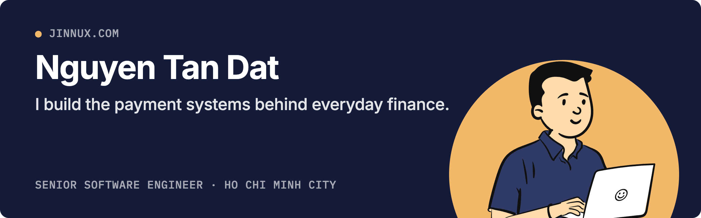
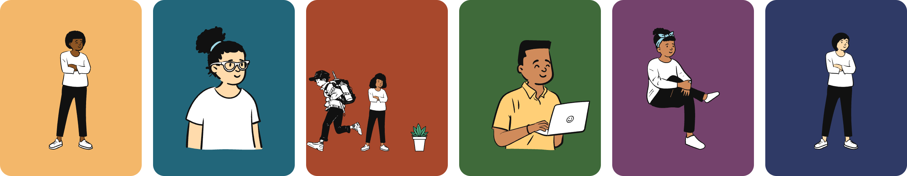

  
  
  
  

I'm Dat, a Senior Software Engineer at Zalo. Most of my work sits where money moves between companies: lending partners, bill payment providers and banks. I care about the parts that keep it boring in the best sense: correct, observable, and easy to extend to the next partner.

After hours I do the opposite, and make small tools that are fun to use.

## Systems that move money

The code is private, so here is what it did.

| Result | What | Where |
|--:|---|---|
| **0** | code changes to onboard a new partner, on a loan and payment platform I architected | Zalo |
| **4** | revenue mini-apps shipped with lending and banking partners | Zalo |
| **~30K** | daily users on a new bill payment flow | Zalo |
| **$320K** | licensing fees removed per year, with a localization tool used across 100+ games | Nexon |
| **−75%** | monthly translation cost, after replacing third-party software with an in-house platform | Nexon |

## Things I make after hours

**[PeepCraft](https://peepcraft.jinnux.com)** is a character creator: build a person from hair, faces, bodies and poses, set them in a scene, and export it. Use it in the browser, from a terminal, or let an AI agent draw through its MCP server. Every picture here was drawn with it.

[Open PeepCraft](https://peepcraft.jinnux.com) · [Support it on Ko-fi](https://ko-fi.com/jinnux)

## What I work with

         
